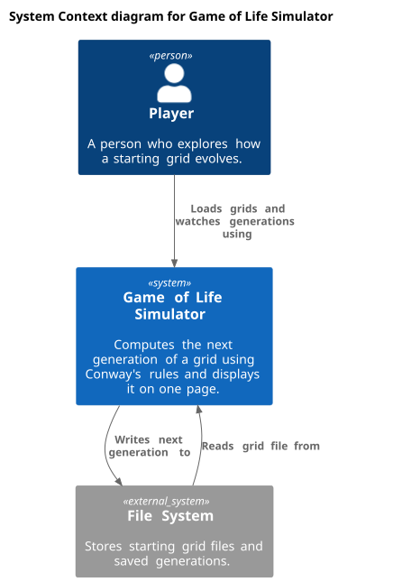

# 3. System Scope and Context

This chapter defines where the Game of Life Simulator ends and its environment
begins. It reuses the existing C4 System Context diagram rather than replacing it.

## 3.1 System Scope

The system is the **Game of Life Simulator**: one Python application that computes
successive generations of a grid using Conway's rules and makes the result
available to a player. Everything that implements the rules or presents them is
inside the boundary:

- the shared Game Engine core library (rules and in-memory grid data),
- the CLI, which calls the engine directly,
- the Flask backend and the Web UI page it serves, which call the engine on behalf
  of a browser.

The engine performs no I/O. File reading and writing therefore happen in the
interfaces, but the file system itself is outside the system boundary.

Outside the boundary are:

- the **Player**, the human actor who loads a grid, advances generations and saves
  results;
- the **File System**, which holds the starting grid files and saved generations as
  plain text.

Not part of the system scope (see Chapter 1, section 1.4 and Chapter 2, section 2.2):
a database, multi-player or concurrent access, grid history/undo, authentication,
and deployment infrastructure (covered separately in Chapter 7).

## 3.2 System Context Diagram

Source: [`diagrams/c4-context.puml`](diagrams/c4-context.puml) (existing file, reused
unchanged).

The diagram shows the simulator as a single black box. The Flask backend is not
drawn here because it is internal to the system; it is introduced as a separate
container in Chapter 5.

## 3.3 External Entities and Interfaces

| Entity | Type | Interaction with the system |
| --- | --- | --- |
| Player | Person | Uses the CLI or the Web UI page to load a starting grid, watch generations and save a generation. |
| File System | External system | Supplies the starting grid file to the interfaces, and receives the saved generation written by them. |

The content crossing the file-system boundary follows the format fixed in Chapter 1:
headerless plain text, one line per row, `*` for a living cell and `.` for a dead
cell, all rows of equal length. Invalid files result in a clear error message to the
player rather than being processed (Chapters 1 and 2).

| Interface | Direction | Carrier | Consumes / produces |
| --- | --- | --- | --- |
| Player → CLI | In | Command-line input | Grid load, advance and save commands |
| CLI → Player | Out | Terminal output | Rendered grid or error message |
| Player → Web UI | In | Browser interaction via the Flask backend | Grid load, advance and save requests |
| Web UI → Player | Out | Served page | Rendered grid or error message |
| Interfaces ↔ File System | In / out | Plain text files | Starting grid read; next generation written |
