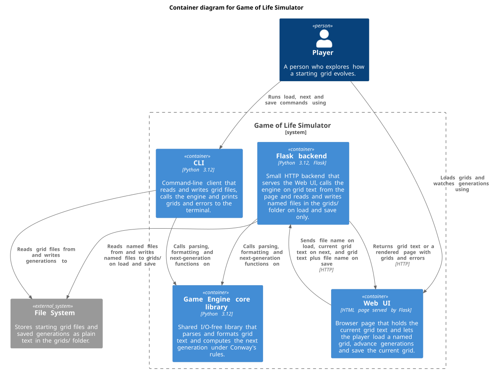
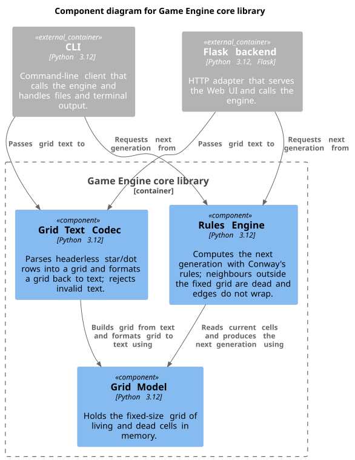
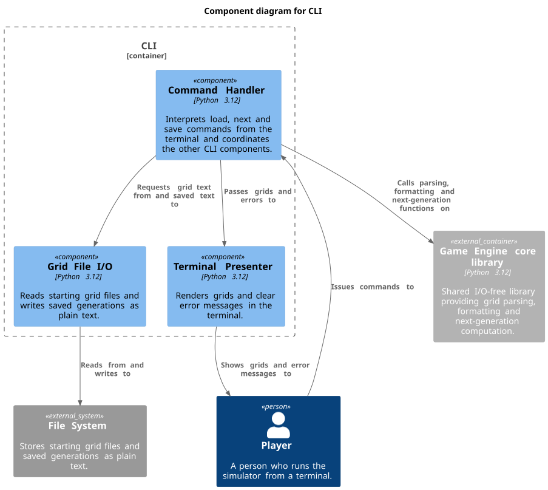
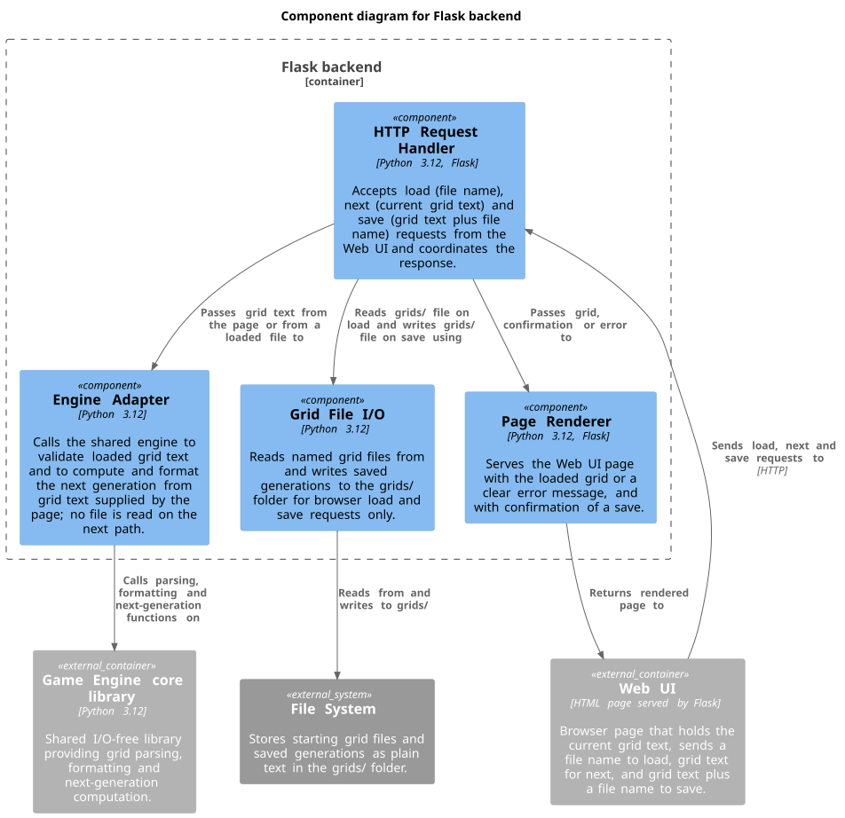

# 5. Building Block View

This chapter shows the static building blocks of the Game of Life Simulator at two
levels: containers (level 2) and components inside the key containers (level 3).
The system-level view is the context diagram from Chapter 3.

## 5.1 Level 1: System Context

At the outermost level the simulator is one system used by a **Player** and backed by
the **File System** for plain-text grid storage. See Chapter 3 and the existing
[`c4-context.puml`](diagrams/c4-context.puml). The Flask backend is inside this
boundary, so it is not shown at level 1.

## 5.2 Level 2: Container View

Source: [`c4-container.puml`](diagrams/c4-container.puml).

| Container | Technology | Responsibility |
| --- | --- | --- |
| CLI | Python 3.12 | Command-line client for terminal users: reads and writes grid files, calls the engine, prints grids and clear error messages. |
| Web UI | HTML page served by Flask | Browser page that holds the current grid text, lets the player enter a file name to load or save, and advances generations from the grid text it holds. |
| Flask backend | Python 3.12, Flask | Small HTTP backend that serves the Web UI, calls the engine on grid text from the page, and reads or writes named files in `grids/` only on load or save. |
| Game Engine core library | Python 3.12 | Shared, I/O-free library that parses and formats grid text and computes the next generation under Conway's rules. |

The **Player** (a person) and the **File System** (plain text files in `grids/`) are
outside the system boundary. There is no database container, and the engine is a
library used by both client containers rather than a separate running service. The
Flask backend is a distinct container between the Web UI and the engine, as agreed
after Chapter 1.

| From | To | Purpose |
| --- | --- | --- |
| Player | CLI / Web UI | Loads a grid, advances generations and saves results. |
| Web UI | Flask backend | Sends a file name on load, current grid text on next, and grid text plus a file name on save over HTTP. |
| Flask backend | Web UI | Returns grid text or a rendered page with grids and errors. |
| CLI / Flask backend | Game Engine core library | Calls parsing, formatting and next-generation functions. |
| CLI / Flask backend | File System | Reads starting grid files and writes saved generations; Flask uses named files in `grids/` on load and save only. |

## 5.3 Level 3: Component Views

### 5.3.1 Game Engine core library

Source: [`c4-component-engine.puml`](diagrams/c4-component-engine.puml).

| Component | Responsibility |
| --- | --- |
| Grid Text Codec | Parses headerless text rows of living/dead cell symbols into an in-memory grid and formats a grid back to text. Rejects text that does not follow the agreed format. |
| Grid Model | Holds the fixed-size grid of living and dead cells in memory. The grid dimensions come from the content and do not change between generations. |
| Rules Engine | Computes the next generation with Conway's rules: survival with two or three living neighbours, birth with exactly three, all other cells dead; neighbours outside the grid are dead and edges do not wrap. |

The engine has no file, terminal or HTTP I/O: it accepts and returns text and grid
data only. Both the CLI and the Flask backend call the same components, which is what
guarantees consistent rules behaviour across interfaces.

### 5.3.2 CLI

Source: [`c4-component-cli.puml`](diagrams/c4-component-cli.puml).

| Component | Responsibility |
| --- | --- |
| Command Handler | Interprets load, next and save commands from the terminal and coordinates the other CLI components. |
| Grid File I/O | Reads starting grid files and writes saved generations as plain text. |
| Terminal Presenter | Renders grids and clear error messages in the terminal. |

### 5.3.3 Flask backend

Source: [`c4-component-flask-backend.puml`](diagrams/c4-component-flask-backend.puml).

| Component | Responsibility |
| --- | --- |
| HTTP Request Handler | Accepts load (file name), next (current grid text) and save (grid text plus file name) requests from the Web UI and coordinates the response. |
| Engine Adapter | Calls the shared engine to validate loaded grid text and to compute and format the next generation from grid text supplied by the page; the next path reads no file. |
| Grid File I/O | Reads named grid files from and writes saved generations to the `grids/` folder for browser load and save requests only. |
| Page Renderer | Serves the Web UI page with the loaded grid or a clear error message, and with confirmation of a save. |

### 5.3.4 Web UI

The Web UI is kept as a single page and has no documented internal components. It
holds the current grid text in the browser, displays that grid and advances it by
sending the text to the Flask backend. File names are entered by the player for load
and save; the returned grid or error message is shown on the page.

## 5.4 Trace to Earlier Decisions

| Decision (Chapter 1 / ADR-001) | Where it appears in this view |
| --- | --- |
| Shared Python engine, no I/O, no database (ADR-001) | Game Engine core library container; no database container; file I/O in the CLI and Flask backend. |
| Grid text file format (decision 1, to be ADR-002) | Grid Text Codec in the engine; Grid File I/O in both interfaces. |
| Fixed-size grid with dead cells outside and no wrapping (decision 2, to be ADR-003) | Grid Model and Rules Engine. |
| Flask backend serving the Web UI (decision 3, to be ADR-004) | Flask backend container and its four components. |
| Web UI holds current grid text; Flask reads/writes named files in `grids/` on load/save only (ADR-005) | Web UI container, Flask Grid File I/O and Engine Adapter. |
