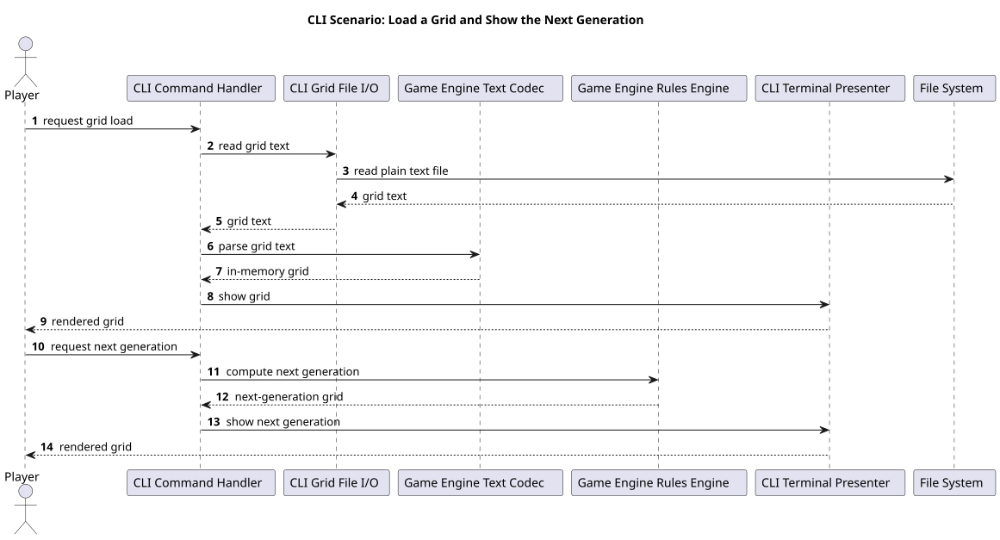
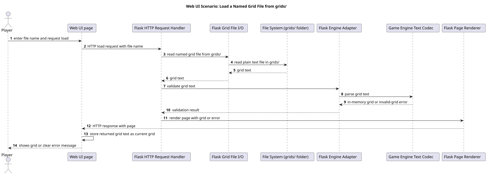
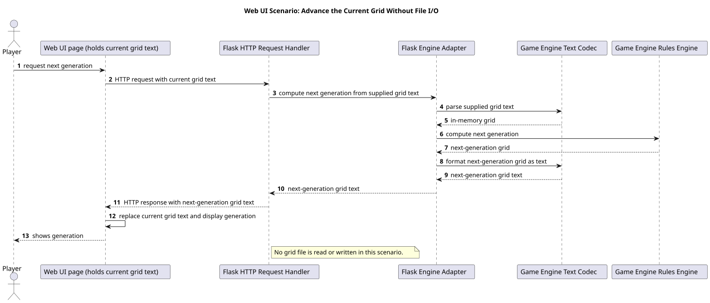
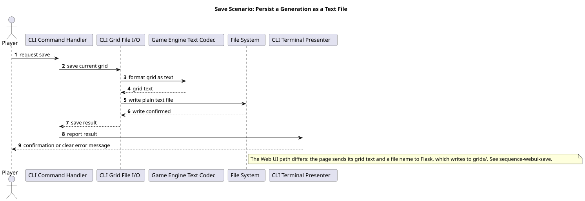
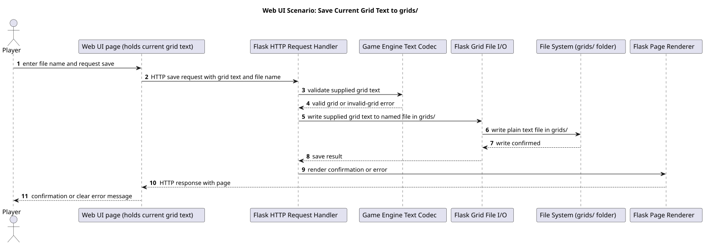
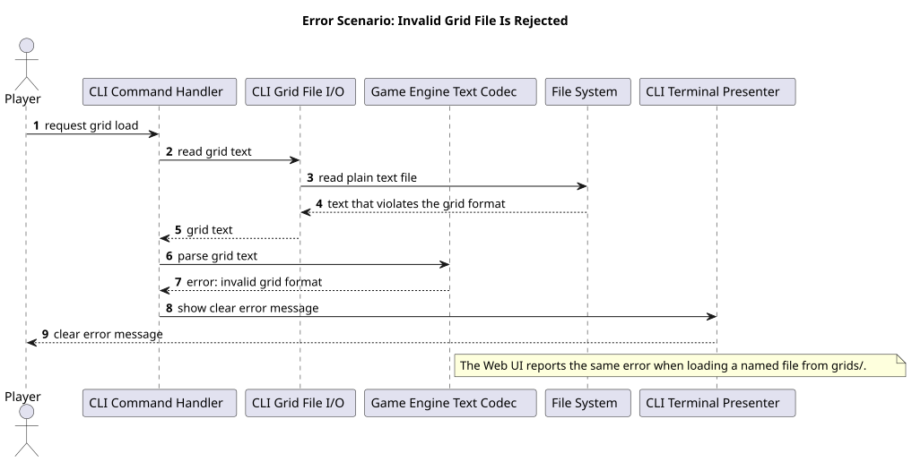

# 6. Runtime View

This chapter describes the behaviour of the Game of Life Simulator at runtime for the
key scenarios. Each sequence diagram uses the container and component names defined
in Chapter 5: the CLI and Flask backend are the only elements that touch the file
system, while the Game Engine only receives text or grid data and returns results.

For the Web UI, the page holds the current grid text in the browser. Flask reads a
named file in the `grids/` folder only on load and writes one only on save; the next
generation is computed from the grid text supplied by the page, with no file access
(ADR-005).

## 6.1 Scenario: Load and Advance a Grid (CLI)

Source: [`sequence-cli-load-and-next.puml`](diagrams/sequence-cli-load-and-next.puml).

1. The player requests a grid load from the CLI Command Handler.
2. CLI Grid File I/O reads the plain text file from the File System.
3. The Game Engine Text Codec parses the text into an in-memory grid, and the
   Terminal Presenter shows the grid.
4. The player requests the next generation. The Command Handler calls the Game
   Engine Rules Engine directly.
5. The Rules Engine computes the next generation from the current grid; the
   Terminal Presenter renders it. No file is written unless the player asks to save.

## 6.2 Scenario: Advance a Generation in the Web UI

### 6.2.1 Prerequisite: load a named grid file

Source: [`sequence-webui-load.puml`](diagrams/sequence-webui-load.puml).

1. The player enters a file name on the Web UI page and requests a load.
2. The page sends the file name to the Flask HTTP Request Handler.
3. Flask Grid File I/O reads that named file from the `grids/` folder; the Engine
   Adapter and Grid Text Codec parse it for validation.
4. The Page Renderer returns a page containing the grid or a clear error message.
5. The page stores the returned grid text as its current grid and shows it.

### 6.2.2 Next generation from the page's current grid text

Source: [`sequence-webui-next.puml`](diagrams/sequence-webui-next.puml).

1. The player requests the next generation on the Web UI page.
2. The page sends an HTTP request containing its current grid text to the Flask HTTP
   Request Handler. **No file name is sent and no file is read.**
3. The Engine Adapter passes the supplied text to the Game Engine Text Codec for
   parsing, then asks the Rules Engine for the next generation and formats the result
   back to text.
4. Flask returns the next-generation grid text in the HTTP response.
5. The page replaces its current grid text with the returned text and displays the
   generation.

The same path handles grids up to the 100x100 target from Chapter 1; the engine
performs only the in-memory computation.

## 6.3 Scenario: Save a Generation

### 6.3.1 CLI save

Source: [`sequence-save-generation.puml`](diagrams/sequence-save-generation.puml).

1. The player requests a save from the CLI.
2. CLI Grid File I/O asks the Game Engine Text Codec to format the current in-memory
   grid as headerless `*` / `.` text.
3. Grid File I/O writes the text to a plain text file in the File System and reports
   the result to the player through the Terminal Presenter.

### 6.3.2 Web UI save

Source: [`sequence-webui-save.puml`](diagrams/sequence-webui-save.puml).

1. The player enters a file name on the Web UI page and requests a save.
2. The page sends its current grid text and the file name to the Flask HTTP Request
   Handler.
3. Flask validates the supplied grid text through the shared Grid Text Codec.
4. Flask Grid File I/O writes the supplied grid text to the named file in the
   `grids/` folder.
5. The Page Renderer returns a page with a confirmation or a clear error message.

## 6.4 Scenario: Invalid Grid File

Source: [`sequence-invalid-file.puml`](diagrams/sequence-invalid-file.puml).

1. The player requests a grid load; the interface reads the file from the File System.
2. The Game Engine Text Codec parses the text and detects that it violates the
   agreed format.
3. The codec reports an invalid-grid error to the caller. No generation is computed.
4. The interface's presenter or page renderer shows a clear error message to the
   player.

This realises the Chapter 1 requirement that invalid files are rejected rather than
processed, and the Chapter 1 quality target for a clear error message. In the Web UI
this applies when loading a named file from `grids/` (ADR-005).

## 6.5 Runtime Notes

- The engine never reads or writes files, prints to a terminal or serves HTTP; all
  I/O stays in the CLI and Flask backend.
- The Web UI page holds the current grid in the browser. Flask keeps no server-side
  grid state between requests and touches `grids/` only on load and save.
- The grid is fixed-size and edges do not wrap, so the Rules Engine needs no
  special state between generations beyond the current grid.
- The earlier open point about Web UI file selection is resolved by ADR-005: the
  player enters a file name and Flask resolves it inside `grids/`. ADR-006 further
  restricts those names to letters, digits, hyphens, underscores and `.txt`, with a
  clear error for anything else.
- Remaining open points are listed in Chapters 7, 8, 10 and 11 (deployment details,
  error-message wording, format edge cases and performance measurement).
