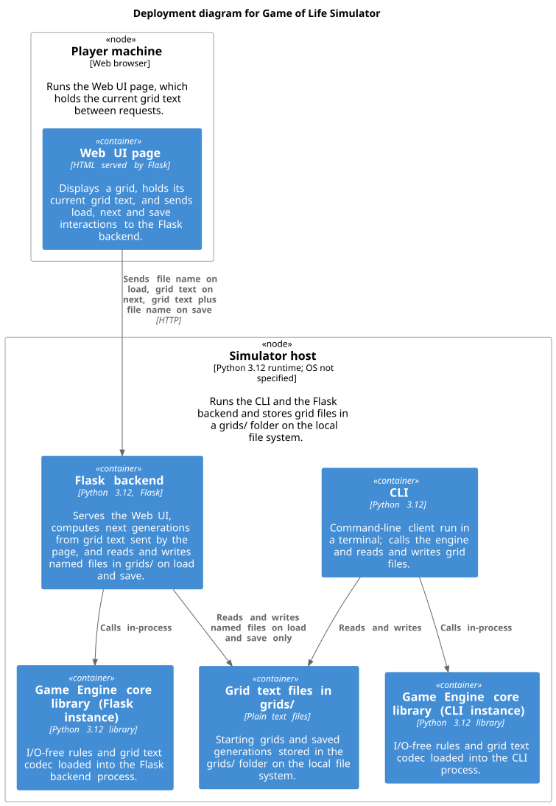

# 7. Deployment View

This chapter maps the containers from Chapter 5 onto runtime locations. The available
material prescribes neither an operating system, a hosting platform nor network
details, so this view stays minimal and marks those items as open rather than
choosing them.

## 7.1 Deployment Diagram

Source: [`c4-deployment.puml`](diagrams/c4-deployment.puml).

| Node | Deployed elements | Role |
| --- | --- | --- |
| Player machine (web browser) | Web UI page | Holds the current grid text in the browser, displays it and sends load, next and save interactions to the Flask backend over HTTP. |
| Simulator host (Python 3.12 runtime; OS not specified) | CLI, Flask backend, Game Engine core library instances, grid text files in `grids/` | Runs both interfaces and stores the grids in a `grids/` folder on the local file system. |

Notes on the mapping:

- The **Game Engine core library** is loaded in-process by the CLI and by the Flask
  backend; it is not a separately deployed service. The diagram therefore shows one
  library instance per calling process.
- The **grid text files** live in a `grids/` folder on the file system of the
  simulator host. The CLI reads and writes them, while Flask reads a named file on
  load and writes one on save. The next-generation path uses grid text from the
  page and does not touch this folder (ADR-005). They are files, not a database; no
  database node appears in the diagram.
- The **Web UI page** is served by the Flask backend to a browser on the player
  machine and holds the current grid text between requests. The only inter-node
  connection is HTTP between the page and the backend.

## 7.2 Runtime Requirements

| Element | Requirement | Source |
| --- | --- | --- |
| Simulator host | Python 3.12 runtime available to run the CLI and the Flask backend. | Chapter 2, T-1; ADR-001 |
| Flask backend | Flask available in the Python environment. | Chapter 1 decision 3; Chapter 2, T-5 |
| Grid files | A `grids/` folder on the host's local file system, with read access for loading named grids and write access for saving named generations. | F-1, F-4; ADR-001; ADR-005 |
| Player machine | A web browser able to display the served page and send HTTP requests. | Chapter 5 Web UI container |
| External services | None required; there is no database and no separate engine service. | ADR-001; Chapter 4 |

## 7.3 Deployment Notes and Open Points

- Bringing the system up consists of making the Python code and grid files available
  on the host, running the CLI in a terminal or starting the Flask backend, and
  opening the served page in a browser. No packaging, installer or orchestration
  mechanism is defined by the material available so far.
- Operating system, browser support, host names, ports and whether the browser runs
  on the same machine as the backend are not specified (see Chapter 2, section 2.1).
  They are left open here.
- The former open point about Web UI file selection is resolved by ADR-005: the
  player enters a file name and Flask resolves it inside the host's `grids/` folder
  for load and save. No server-side grid state is stored between requests.
- No scaling, clustering, high availability or multi-user deployment is described;
  these are outside the kata's scope (Chapter 1, section 1.4).
